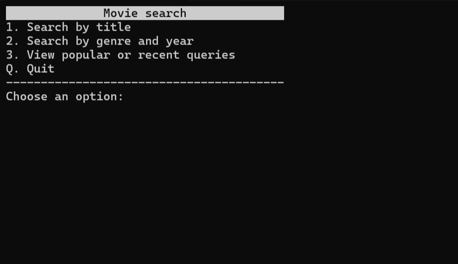
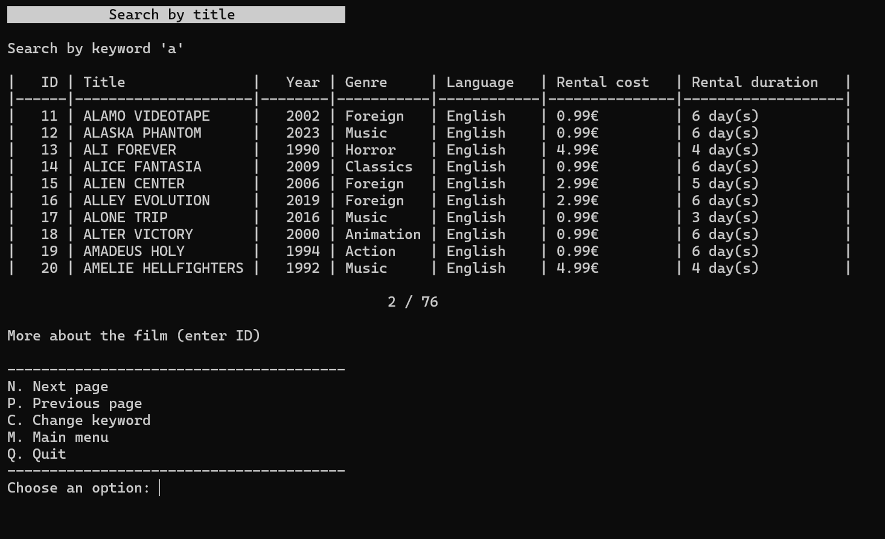
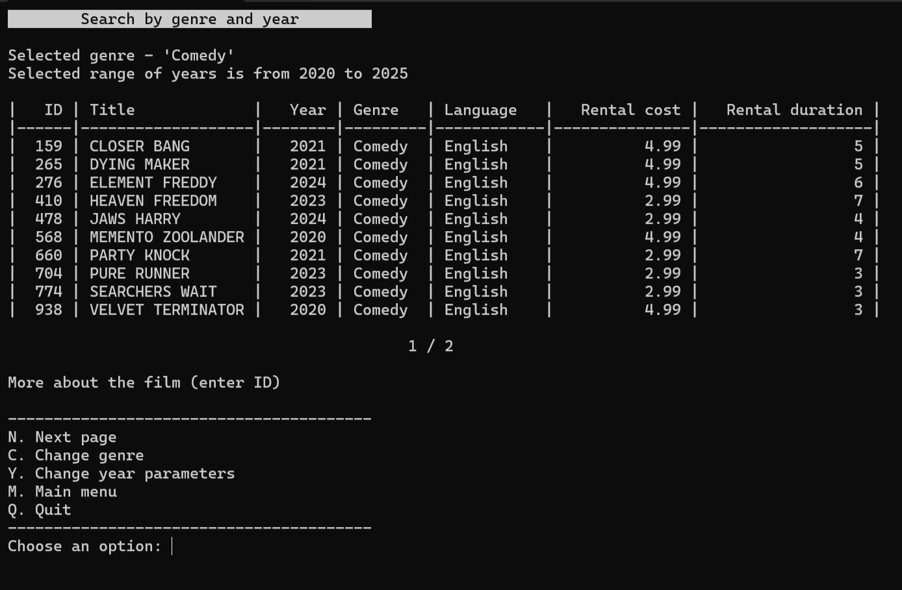
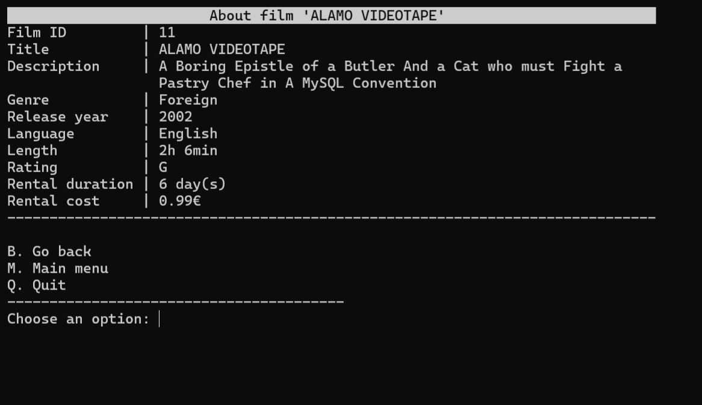
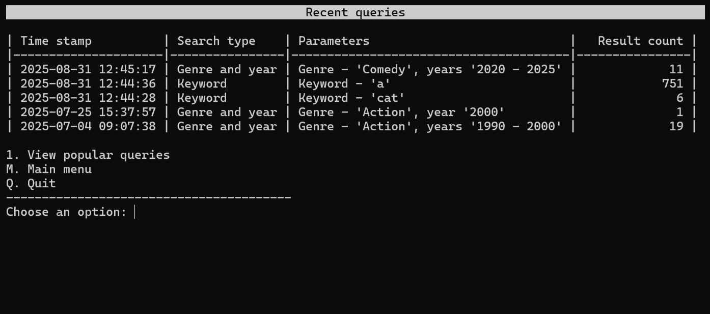

# 🎬 Interactive Movie Search

Interaktive Konsolenanwendung in Python, mit der Filme aus einer MySQL-Datenbank (`sakila`) gesucht und analysiert werden können. Alle Suchanfragen werden in MongoDB gespeichert, und die Anwendung zeigt eine Statistik der beliebtesten sowie letzten Suchanfragen.

---

## ✨ Funktionen

- **Filmsuche:**
  - Nach Schlüsselwort oder Titel (mit Paginierung: jeweils 10 Ergebnisse pro Seite)
  - Nach Genre und Veröffentlichungsjahr (Angabe eines konkreten Jahres `YYYY`, eines Zeitraums `YYYY YYYY` oder ohne Jahreseinschränkung)
- **Detaillierte Filmansicht:**
  - Vollständige Informationen zu einem ausgewählten Film aus der Ergebnisliste (Beschreibung, Besetzung, Sprache, Laufzeit, Altersfreigabe, Mietdauer und -preis)
- **Speicherung & Statistik von Suchanfragen (MongoDB):**
  - Protokollierung aller Suchanfragen mit Zeitstempel, Suchparametern und Trefferanzahl
  - Auswertung der **5 beliebtesten Suchanfragen** nach Häufigkeit (Aggregation Pipeline) sowie der **5 letzten Suchanfragen**
- **Benutzerfreundliche Konsolen-UI & Logging:**
  - Strukturierte Tabellenausgabe, Farbhervorhebungen und zentrale Fehlerprotokollierung (`app.log`)

---

## 🛠 Technologien & Architektur

- **Sprache:** Python 3
- **Datenbanken:** MySQL (`sakila` – Filmdaten), MongoDB (Protokollierung & Aggregation von Suchanfragen)
- **Bibliotheken:** `pymysql`, `pymongo`, `pandas`, `colorama`, `python-dotenv`
- **Projektstruktur:**
  - `main.py` — Einstiegspunkt & Programmablauf
  - `action.py` — Eingabevalidierung, Paginierung & Interaktionslogik
  - `user_interface.py` — Konsolenmenüs & Tabellenformatierung
  - `mysql_connector.py` — SQL-Abfragen & Datenbankverbindung
  - `mongo_connector.py` — Speicherung & Aggregation der Suchanfragen
  - `settings.py` — Konfiguration über `.env` & SQL-Queries
  - `logger.py` — Dekorator `@log_error` & Logging (`app.log`)

---

## ⚙️ Installation & Nutzung

- **Repository klonen:**
  `git clone [https://github.com/AleX5andr/interactive_movie_search.git](https://github.com/AleX5andr/interactive_movie_search.git) && cd interactive_movie_search`
- **Abhängigkeiten installieren:**
  `pip install -r requirements.txt`
- **Datenbanken vorbereiten:**
  - **MySQL:** `sakila`-Datenbank einrichten
  - **MongoDB:** Datenbank (`ich_edit`) und Collection für Suchanfragen vorbereiten
- **Umgebungsvariablen (`.env`) anlegen:**
  `SQL_HOST=...`, `SQL_USER=...`, `SQL_PASSWORD=...`, `MONGO_HOST=...`, `MONGO_USER=...`, `MONGO_PASSWORD=...`
- **Anwendung starten:**
  `python main.py` (anschließend den Anweisungen im Konsolenmenü folgen, um Filme zu suchen, Details anzusehen oder die Statistik zu prüfen)

---

## 📸 Screenshots

### Hauptmenü

### Filmsuche nach Keyword

### Filmsuche nach Genre und Jahr

### Film Detailansicht

### Statistik der Suchanfragen

---

## 👤 Autor & Lizenz

**Projekt von Oleksandr Muntian**  
- LinkedIn: [Oleksandr Muntian](https://www.linkedin.com/in/oleksandr-muntian-6762692b1/)  
- Lizenz: Dieses Projekt ist unter der **MIT-Lizenz** lizenziert.
